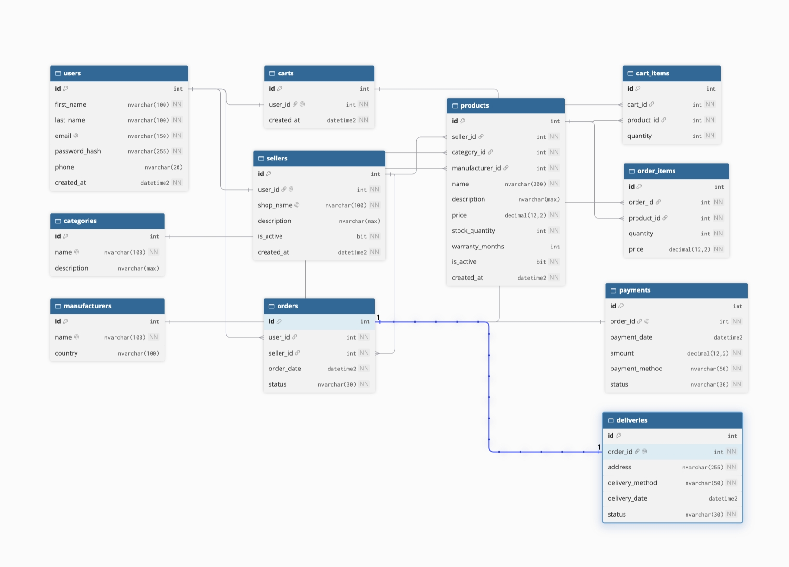

# TechStore — интернет-магазин электроники

Учебный проект: база данных и настольное приложение интернет-магазина электроники.
Покупатель просматривает каталог и оформляет заказы, а любой пользователь может создать
в профиле свой магазин и стать продавцом.

## Технологии

- СУБД: Microsoft SQL Server (SQL Server Express)
- Приложение: C#, WPF (.NET Framework), Entity Framework (Database First)
- Среда разработки: Visual Studio

## Возможности

**Все пользователи**
- Регистрация и вход по email и паролю (пароли хранятся в виде хеша PBKDF2 с солью)
- После трёх неверных попыток входа появляется капча
- Смена пароля, редактирование профиля
- Каталог: поиск по названию, фильтр по категории, сортировка по цене и названию
- Корзина, оформление заказа (курьер, самовывоз, почта; карта, СБП, при получении)
- Просмотр своих заказов
- Светлая и тёмная тема (выбор запоминается)

**Продавец** (магазин создаётся в профиле)
- Добавление, изменение и удаление товаров
- Заказы магазина: отправка, доставка, отмена с возвратом товара на склад
- Отчёты и графики: выручка по товарам и категориям, заказы по статусам

Подтверждение запрашивается перед выходом, удалением товара и отменой заказа.

## База данных

Таблицы: `users`, `sellers`, `categories`, `manufacturers`, `products`, `carts`, `cart_items`,
`orders`, `order_items`, `payments`, `deliveries`.

- Первичные и внешние ключи, `CHECK`-ограничения на цены, количество и статусы
- Каскадное удаление: заказ удаляет свои позиции, оплату и доставку; корзина удаляет свои позиции
- Триггеры: нельзя купить товар собственного магазина; товар в заказе должен принадлежать продавцу заказа
- Тестовые данные включены в скрипт

## Схема базы данных



## Запуск

1. Откройте `Database/TechStoreDB.sql` в SQL Server Management Studio и выполните целиком
   (скрипт пересоздаёт базу `TechStoreDB`).
2. Выполните `Database/AddCascade.sql` (каскадное удаление для корзин).
3. Откройте решение в Visual Studio.
4. В `App.config` в строке подключения (`data source=...`) укажите свой сервер
   (например, `.\SQLEXPRESS` или `localhost`).
5. Соберите и запустите проект.

## Тестовые учётные записи

Пароль у всех: `123456`

| Email | Роль |
|---|---|
| ivan@example.com | покупатель |
| olga@example.com | покупатель |
| maria@example.com | продавец (магазин TechWorld) |
| alex@example.com | продавец (магазин GadgetHub) |

## Структура репозитория

```
Database/        скрипты базы данных и схема
MiracleShoesWPF/ исходный код приложения (Pages, Themes, Dictionary.xaml, модель EF)
README.md
```
